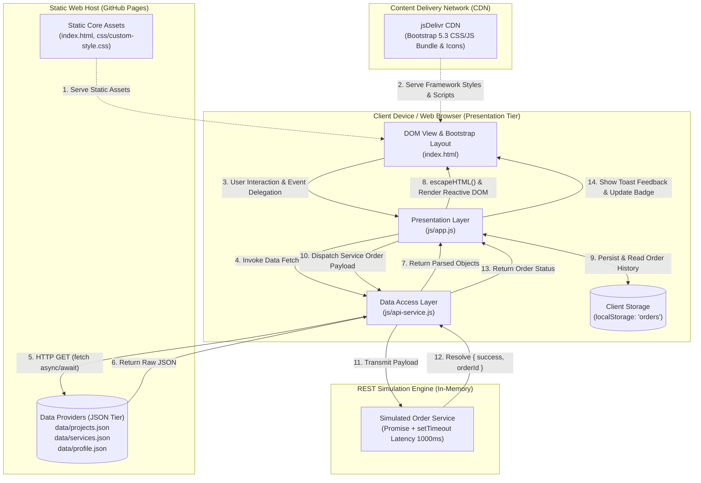

# 🌟 Portofolio Profil Web Modern - Michael Pratama Nasution

<p align="center">
  
</p>

<p align="center">
  <a href="https://github.com/MichaelNasution"></a>
  
  
  
  
</p>

<p align="center">
  
  
  
  
  
</p>

---

## 🔗 Tautan Demo Langsung & Repositori

- **Live Demo (GitHub Pages)**: [https://michaelnasution.github.io/ppw-2026-week2-12S24003/](https://michaelnasution.github.io/ppw-2026-week2-12S24003/) *(URL live demo)*
- **Branch Kerja**: `week4-architecture`
- **Repositori**: `MichaelNasution/ppw-2026-week2-12S24003`

---

## 🏛️ 1. Diagram Arsitektur C4 Container

Arsitektur aplikasi pada Minggu 04 ditransformasi dari struktur HTML monolitik statis menjadi **Decoupled Multi-Tier Architecture** dengan **Dynamic Client-Side Rendering (CSR)**:



---

## 🧩 2. Narasi Separation of Concerns (SoC)

Arsitektur kode menerapkan prinsip **Separation of Concerns (SoC)** secara ketat melalui pembagian 3 lapisan utama:

1. **Presentation Layer (`js/app.js`)**:
   - Bertanggung jawab sepenuhnya atas manipulasi DOM, manajemen *state* lokal aplikasi (`projects`, `services`, `profile`, `activeFilter`, `orders`), *event delegation* terpusat, pengisian *Universal Modal*, pemfilteran kategori di memori, penanganan status UI (*Loading*, *Error*, *Empty State*), sanitasi input melalui `escapeHTML()`, dan umpan balik pengguna (*Toast notification* & badge navbar reaktif).
   - Lapisan ini tidak melakukan pemanggilan `fetch()` langsung ke endpoint atau berkas, melainkan mendelegasikannya ke `ApiService`.

2. **Data Access Layer (`js/api-service.js`)**:
   - Bertindak sebagai gerbang komunikasi data (*Data Access Object / Service Abstraction*).
   - Menyediakan metode asinkron (`getProjects()`, `getServices()`, `getProfile()`, `submitServiceOrder()`) dengan validasi `response.ok`, konversi JSON, penanganan kesalahan (*error re-throwing*), dan simulasi *latency* jaringan.
   - Lapisan ini sama sekali tidak mengetahui struktur DOM maupun antarmuka pengguna.

3. **Data Layer (`data/*.json`)**:
   - Merupakan penyedia data murni (*Single Source of Truth*) yang terpisah dari struktur penyajian HTML.
   - Terdiri dari `data/projects.json`, `data/services.json`, dan `data/profile.json`. Pemisahan ini memfasilitasi pemeliharaan data tanpa perlu menyentuh markup presentasi.

---

## ⚖️ 3. Tabel Komparasi: Sebelum vs Sesudah Refactoring (Week 3 vs Week 4)

| Aspek / Komponen | Sebelum (Week 3 - Static Hardcoded Bootstrap) | Sesudah (Week 4 - Decoupled Dynamic CSR) |
| :--- | :--- | :--- |
| **Sumber Data** | Data proyek, profil, dan layanan ditulis keras (*hardcoded*) langsung di dalam berkas `index.html`. | Terpisah penuh di `data/projects.json`, `data/services.json`, dan `data/profile.json` (*Data Decoupling*). |
| **Siklus Hidup Rendering** | Statis murni; seluruh elemen kartu dan teks dibuat saat berkas HTML pertama kali dibaca browser. | **Client-Side Rendering (CSR)** dinamis dengan dukungan **Loading State** (spinner), **Error State** (alert + tombol coba lagi), dan **Empty State**. |
| **Modal Dialog** | 4 elemen modal terpisah (`#modalCashflow`, `#modalTelegram`, dll.) yang menyebabkan redundansi DOM. | **1 Universal Modal** (`#universalProjectModal`) yang dikontrol secara dinamis via JavaScript dan *Event Delegation*. |
| **Interaksi Formulir** | Pengiriman formulir tradisional yang memicu *page reload* penuh (`POST` bawaan form). | **Pengiriman REST Asinkron** via `fetch`/simulasi tanpa reload, dilengkapi *loading indicator* pada tombol submit dan notifikasi **Bootstrap Toast**. |
| **Keamanan (Security)** | Tanpa sanitasi data; rentan terhadap injeksi Cross-Site Scripting (XSS). | Dilengkapi fungsi sanitasi **`escapeHTML()`**, penetapan judul via **`textContent`**, serta penerapan **Content Security Policy (CSP)** di `<head>`. |
| **Penyimpanan Riwayat** | Tidak ada penyimpanan lokal; data formulir hilang setelah halaman ditutup atau di-refresh. | Persistensi ke **`localStorage`** dengan key `"orders"` serta sinkronisasi reaktif ke **badge navbar** secara otomatis. |
| **Filter & Navigasi Data** | Tanpa fitur filter kategori proyek. | **Filter Kategori Dinamis** yang dihasilkan dari data unik proyek dan memfilter kartu instan langsung dari memori tanpa *re-fetch*. |

---

## 📊 4. Hasil Pengukuran Kinerja Browser DevTools (Tahap 6)

Pengukuran metrik jaringan dilakukan menggunakan Google Chrome DevTools pada tab **Network** (dengan opsi throttling *Disable Cache* untuk Cold Load dan *Enable Cache* untuk Warm Load):

| Metrik Kinerja | Cold Load (Cache Mati) | Warm Load (Cache Aktif) | Selisih / Penghematan |
| :--- | :---: | :---: | :---: |
| **Time to First Byte (TTFB)** | *(diisi manual)* | *(diisi manual)* | *(diisi manual)* |
| **First Contentful Paint (FCP)** | *(diisi manual)* | *(diisi manual)* | *(diisi manual)* |
| **Jumlah Request HTTP** | *(diisi manual)* | *(diisi manual)* | *(diisi manual)* |
| **Total Transfer Size** | *(diisi manual)* | *(diisi manual)* | *(diisi manual)* |
| **Status Cache File JSON** | 200 OK (Transfer Jaringan) | 200 / 304 (from disk/memory cache) | *(diisi manual)* |

### Tangkapan Layar Analisis Waterfall DevTools:

> *Placeholder tangkapan layar waterfall dari tab Network DevTools:*

| Cold Load Network Waterfall | Warm Load Network Waterfall |
| :---: | :---: |
|  |  |

---

## ⚙️ 5. Catatan Pilihan Arsitektur `submitServiceOrder`

Pada metode `ApiService.submitServiceOrder(payload)`, arsitektur menggunakan **Promise dengan simulasi `setTimeout` (1000ms latency)**, bukan mock API eksternal (seperti Mockoon, MockAPI, atau Reqres).

**Rasionalisasi Pemilihan:**
1. **Kompatibilitas Static Hosting**: GitHub Pages adalah penyedia *hosting* statis murni yang tidak mengizinkan penanganan *endpoint* HTTP POST di sisi peladen.
2. **Kemandirian Lingkungan (Zero External Dependency)**: Menggunakan simulasi berbasis Promise internal memastikan aplikasi portofolio tetap dapat didemonstrasikan kapan saja tanpa ketergantungan pada kestabilan server pihak ketiga atau kuota request *mock provider* gratisan.
3. **Replikasi Pengalaman Pengguna Nyata**: Waktu tunda 1000 milidetik mereplikasi jeda jaringan riil (*round-trip latency*), memungkinkan penguji mengamati *loading state* (tombol dinonaktifkan dengan spinner) sebelum umpan balik *Toast* dimunculkan.

---

## 📂 Struktur Berkas Proyek (Minggu 04)

```
ppw-2026-week2-12S24003/
├── index.html              # Antarmuka web utama dengan Universal Modal & CSP meta tag
├── css/
│   └── custom-style.css    # Desain tema Rustic Charm & overrides Bootstrap
├── data/
│   ├── projects.json       # Sumber data portofolio proyek
│   ├── services.json       # Sumber data paket konsultasi & layanan
│   └── profile.json        # Sumber data identitas, biografi, dan keahlian
├── js/
│   ├── api-service.js      # Lapisan Data Access (Fetch abstraction & mock order)
│   └── app.js              # Lapisan Presentasi (DOM controller, CSR, modal, localStorage)
└── README.md               # Dokumentasi arsitektur, komparasi, dan hasil pengujian
```

---

## 👤 Identitas Mahasiswa

- **Nama Lengkap** : Michael Pratama Nasution
- **NIM** : 12S24003
- **Program Studi** : S1 Sistem Informasi
- **Mata Kuliah** : Pemrograman dan Pengujian Aplikasi Web (12S3101)
- **Institusi** : Institut Teknologi Del
- **Tahun Akademik** : 2025/2026
